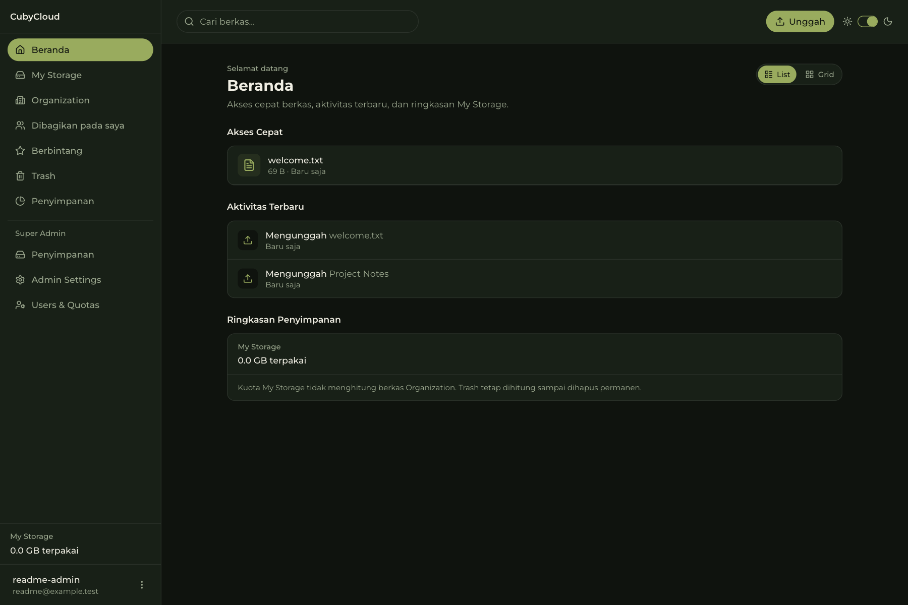
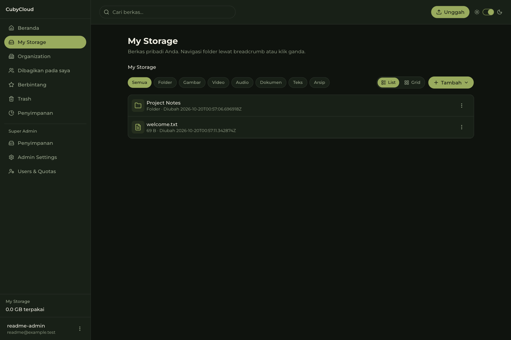
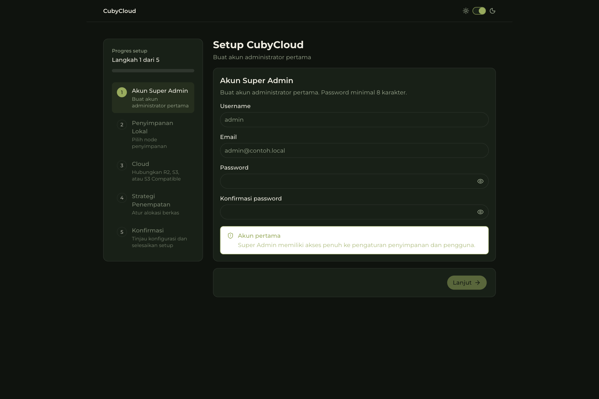
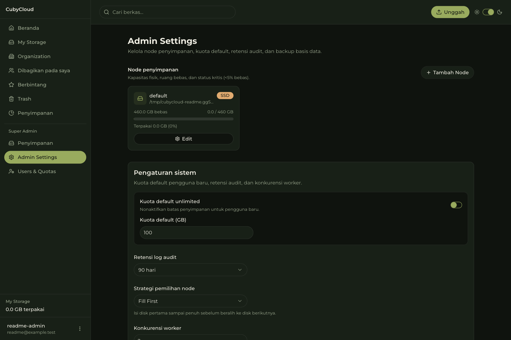

# CubyCloud

**Your files. Your server. Your rules.**

CubyCloud is a self-hosted file drive for people who want a familiar way to organize and share files while choosing where those files live. It combines a Go API, a SvelteKit web app, SQLite, local storage, and optional S3-compatible storage.

[](https://github.com/septian-padli/cubycloud/actions/workflows/docker-publish.yml)
[](https://github.com/septian-padli/cubycloud/pkgs/container/cubycloud)

[](https://go.dev/)
[](https://svelte.dev/)
[](LICENSE)




## Why CubyCloud?

- **Single self-contained container.** The SvelteKit 5 frontend is embedded directly into the Go binary. No Node.js runtime container, PHP-FPM, or separate web server is required.
- **Zero external dependencies.** Powered by SQLite in WAL mode with embedded migrations. You do not need to install, configure, or maintain PostgreSQL, MySQL, Redis, or external brokers.
- **Minimal footprint.** The Alpine runtime image weighs under 150 MB and idles around 30 to 50 MB of RAM, making it fast to deploy and ideal for low-power hardware.
- **Multi-architecture ready.** Native builds for both `linux/amd64` (PC, VPS, Intel/AMD servers) and `linux/arm64` (Raspberry Pi 4/5, Orange Pi, ARM VPS).
- **Keep control of your data.** Store files on local disks you manage or connect S3-compatible object storage.
- **Start in a browser.** The first-run wizard creates the initial administrator and configures storage.
- **Separate personal and shared workspaces.** My Storage and Organization are distinct drives with independent quota policies.

## Features

- **File management:** folders, uploads, rename, move, duplicate, trash, restore, and starred items.
- **Resumable uploads:** browser uploads to My Storage use TUS chunking.
- **File previews:** images, video, PDF, and text/code files can be previewed in the browser.
- **Sharing:** share files and folders with registered users using Viewer or Editor permissions, or create public links with optional password protection.
- **Organization drive:** a shared workspace for registered users, separate from personal My Storage quota accounting.
- **Flexible storage:** local disk and S3-compatible storage, with a MinIO-backed Playwright scenario.
- **Administration:** manage storage nodes, user quotas, system settings, and storage usage.
- **Capacity controls:** My Storage and Organization uploads are checked against the capacity of the physical storage nodes they share.

## Screenshots

### File manager



### First-run setup



### Storage administration



The screenshots were captured from the running application using synthetic local data. The interface currently shown in these captures is Indonesian.

## Quick start

### Docker Compose (recommended)

CubyCloud runs as a single self-contained container with embedded frontend and backend. The Compose file pulls the image from GHCR; it does not build from source. No manual `.env` or secret generation is needed for a standard installation. The image must be publicly available on GHCR before this download-only path works.

1. Download `compose.yaml`:
   ```bash
   curl -O https://raw.githubusercontent.com/septian-padli/cubycloud/main/compose.yaml
   ```
2. Start the container:
   ```bash
   docker compose up -d
   ```
3. Open `http://<IP-server>:8383/setup` from another device on the same LAN, or [http://localhost:8383/setup](http://localhost:8383/setup) on the Docker host. Complete the setup wizard and save your recovery key.

Compose publishes port **8383** on all host interfaces by default, so devices on the LAN can connect. To use another host port, run `CUBYCLOUD_PORT=9000 docker compose up -d` and open `http://<IP-server>:9000/setup`. The container still listens on port 8383. You can also set `CUBYCLOUD_PORT=9000` in a `.env` file beside `compose.yaml`; this file configures Compose, not the application. Do not forward this HTTP port directly to the internet; restrict access with your firewall.

#### Updating CubyCloud

To update an existing installation to the latest published release:

```bash
docker compose pull
docker compose up -d
```

Compose pulls the newer image from GHCR and restarts the container. All SQLite database records, encryption keys, and uploaded files persist safely inside the `cubycloud_data` volume.

#### Docker Volume & Storage Configuration

- **Named volume (default):** `cubycloud_data:/app/data` stores the SQLite database (`db/cubycloud.db`), auto-generated secrets (`secrets/jwt.key`, `secrets/master.key`), and local file storage (`storage/default`).
- **Host bind mount:** To store data directly in a host directory, replace `cubycloud_data:/app/data` with `./data:/app/data` in `compose.yaml`. Ensure the host directory is writable.
- **Secondary storage disks:** To add another local disk, mount it inside the storage directory, e.g. `- /mnt/storage-hdd:/app/data/storage/hdd`. The setup wizard and admin storage scanner will automatically detect it.

#### Reverse Proxy & HTTPS

The Compose file does not include a reverse proxy. To use an existing HTTPS reverse proxy, point its upstream to the Docker host's IP address and published port (8383 by default, or your `CUBYCLOUD_PORT`). Configure the public domain and TLS certificate in the proxy. Restrict access to the direct HTTP port to the proxy and trusted LAN clients with a firewall. A proxy on the same Docker network may instead reach `cubycloud:8383`; joining that network requires configuration outside this Compose file.

For HTTPS-only login, enable `COOKIE_SECURE=true` in the Compose environment. This prevents login over direct HTTP on the LAN. With the current application code, allowing authenticated HTTP LAN and HTTPS proxy access at the same time cannot provide `Secure` cookies on HTTPS without trusting a client-supplied `X-Forwarded-Proto` header on the published LAN port. Do not enable `TRUST_PROXY=true` on that exposed port as a workaround. The embedded frontend uses same-origin API requests, so `ALLOWED_ORIGINS` is not needed for a normal same-domain proxy setup. Use `GET /api/health` for readiness checks; see the [Reverse Proxy Guide](docs/reverse-proxy.md) for proxy examples.
#### Backup and Restore

All state is contained within `/app/data`. To back up CubyCloud, copy or snapshot the entire `/app/data` volume or directory while the service is stopped or using SQLite WAL-safe backup:
- `db/cubycloud.db`: database tables and metadata
- `secrets/jwt.key`: session authentication key
- `secrets/master.key`: master encryption key for encrypted cloud storage credentials
- `storage/`: all locally stored files

To restore, place these files back into `/app/data` before starting the container.

### Run from source

Requirements: **Go 1.25 or newer**, **Bun 1.x**, and OpenSSL to generate a random development secret. Run the backend and frontend in separate terminals from a local checkout.

**Terminal 1: backend**

```bash
cd apps/backend
PORT=8383 \
DATA_DIR_PATH="$HOME/cubycloud-data" \
go run ./cmd/server/main.go
```

**Terminal 2: frontend**

```bash
cd apps/frontend
bun install
VITE_API_PROXY_TARGET=http://localhost:8383 \
bun run dev --host 127.0.0.1 --port 5188
```

Open [http://localhost:5188/setup](http://localhost:5188/setup), create the first administrator, and complete the setup wizard.
## System requirements

CubyCloud is designed to run efficiently on low-power homelab servers, single-board computers, and virtual private servers.

- **Minimum hardware:** 1 CPU core, 1 GB RAM (suitable for single-user personal storage on Raspberry Pi 4 or entry-level VPS).
- **Recommended hardware:** 2 CPU cores, 2 GB RAM (optimized for Intel Celeron mini PCs, small offices, or active family drives).
- **Supported architectures:** `linux/amd64` and `linux/arm64`.
- **Disk space:** 200 MB for container image and SQLite metadata, plus whatever storage capacity you plan to allocate for uploaded files.
- **Source development:** Go 1.25 or newer and Bun 1.x (if building without Docker).
## Architecture and tech stack

| Area           | Implementation                                           |
| -------------- | -------------------------------------------------------- |
| Backend        | Go 1.25, Echo, Bun ORM                                   |
| Database       | SQLite in WAL mode with embedded SQL migrations          |
| Frontend       | SvelteKit 2, Svelte 5, TypeScript, Tailwind CSS 4        |
| Local storage  | Filesystem storage nodes                                 |
| Object storage | S3-compatible services through the AWS SDK for Go v2     |
| Packaging      | Static frontend assets embedded into the Go server build |

The intended production package is a single Go service serving both the API and the built frontend embedded in the binary.

## Development and testing

For the full development setup, configuration, and test details, see [Development](docs/development.md) and [Testing](docs/testing.md).

```bash
make test
```

`make test` runs backend Go tests and the frontend Svelte check. Playwright end-to-end tests are run separately; the S3 integration test requires the optional MinIO development service.

## Documentation

- [API Documentation & Swagger UI (OpenAPI 3.1)](docs/openapi/README.md)
- [Architecture and runtime model](docs/architecture.md)
- [Development setup](docs/development.md)
- [Testing guide](docs/testing.md)
- [Contributing](CONTRIBUTING.md)
- [Security policy and reporting](SECURITY.md)
## Security and privacy

CubyCloud runs on infrastructure you control and stores application data beneath its configured data directory. Implemented safeguards include bcrypt password hashing, HTTP-only `SameSite=Lax` session cookies, rate limiting for login and public-share unlock requests, and encryption of saved S3-compatible storage credentials.

These safeguards do not replace TLS, host security, or backups. CubyCloud does not claim end-to-end encryption for uploaded file contents. See [SECURITY.md](SECURITY.md) for the current vulnerability-reporting guidance; a dedicated private contact channel is not published yet.

## Contributing and community

Bug reports, reproducible examples, and focused pull requests are welcome. Read [CONTRIBUTING.md](CONTRIBUTING.md) before preparing a change. Do not include secrets, recovery keys, or real user data in issues, logs, screenshots, or test fixtures.

## License

Copyright (C) 2026 CubyCloud contributors. CubyCloud is licensed under the GNU Affero General Public License, version 3 or (at your option) any later version. See [LICENSE](LICENSE).

Modified versions used over a network must offer their users access to the corresponding source code under AGPL-3.0 section 13. The source repository is available at [github.com/septian-padli/cubycloud](https://github.com/septian-padli/cubycloud).
